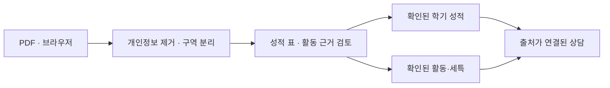

# 생활기록부 자동 추출·DB 저장·성적 및 진로 상담 기획안

작성일: 2026-11-04  
상태: 실제 PDF 구조를 확인한 기획안. 1차 규칙 기반 후보 추출·검토·일괄 저장은 구현했다. 아래는 후속 설계를 포함하며, 문서 등록 이력·전체 개인정보 자동 제거·AI 상담·모든 양식 지원의 완료를 의미하지 않는다.

## 1. 제품 방향

**PDF 한 번 등록 → 학기 종합 성적표 + 활동·세특 근거 목록 자동 생성 → 원본 대조·수정·선택 저장 → 출처가 연결된 성적·진로 상담**으로 구성한다.



현재의 빈 생활기록부 입력 폼을 첫 화면으로 사용하지 않는다. 사람이 원문을 옮겨 적는 대신 추출 후보를 검토하도록 바꾼다. 기존 내신·모의고사·생활기록부 DB와 로그인 체계는 활용한다.

원문에 기록된 사실, 사용자가 작성한 희망 진로, AI가 제안한 해석을 서로 다른 데이터로 관리한다. 확인되지 않은 추출값은 상담의 확정 근거로 사용하지 않는다.

## 2. 제공 PDF에서 확인한 구조와 설계에 미치는 영향

원본은 약 7.96MiB, 12쪽이고 암호화되지 않았다. 12쪽 모두 추출 가능한 텍스트층이 있으며 약 16,430자의 텍스트가 반환됐다. 이것은 추출 정확도 검증 수치가 아니다. 주요 표·문단은 렌더링한 페이지와 함께 확인했다. 원본과 추출문을 외부 AI에 전송하지 않았다.

| PDF 위치 | 확인한 자료 | 처리 계획 |
|---|---|---|
| 1~2쪽 | 인적·학적·출결·수상·자격 등 | 개인 식별정보 제외. 학년-연도 매핑에 필요한 최소 사실만 확인. 출결·수상·자격은 초기 상담의 자동 평가 대상에서 제외 |
| 3~4쪽 | 자율·자치, 동아리, 진로활동 및 일부 미제공 안내 | 학년·활동 구분·시간·원문 근거로 구조화. 서로 다른 동아리는 별도 하위 활동으로 구분 |
| 4~5쪽 | 봉사활동 | 별도 구역으로 인식. 날짜·시간·누계 혼동 방지. 1차 자동 상담에는 넣지 않고 확장 후보로 둠 |
| 5쪽 | 1학년 1·2학기 보통·전문교과 성적, 총 12행 | 학기 종합 성적 검토 표 생성. 중간·기말 개별 시험으로 저장하지 않음 |
| 5~7쪽 | 보통·전문교과 세특 | 과목별 문단 연결. 페이지가 바뀌어도 같은 과목의 문장을 이어 붙임 |
| 7~9쪽 일부 | 체육·예술·과학탐구실험·교양의 성적 및 서술 | 숫자 성적은 기존 계산·저장 대상에서 제외. 세특·활동 서술은 원본 확인 후 진로 상담 근거로 활용 |
| 9쪽 | 2학년 1학기 보통·전문교과 성적, 총 9행 | 학기 종합 성적 검토 표 생성. 등급 공란은 null 유지 |
| 9~11쪽 일부 | 당해 학년도 세특·행특 등 미제공 문구 | `unavailable`로 표시. 미흡·무활동·0점으로 해석하지 않음 |
| 10쪽 | 독서활동 구역, 1학년 행동특성 및 종합의견 | 독서 구역 공란과 세특 안 독서 언급을 구분. 행특은 교사 서술 근거로 관리 |
| 12쪽 | 증명·인적사항 중심 페이지 | 성적·진로 상담 입력에서 제외 |

### 이 파일에서 반드시 처리할 문제

1. **눈에 보이는 가림과 PDF 텍스트 삭제는 다르다.** 렌더링에서는 가려진 일부 식별정보가 추출 텍스트에는 남아 있었다. 이름·학교·학급/번호·문서확인번호·주소·주민등록번호·반복 머리말/꼬리말·증명 정보는 저장 및 외부 전송 전에 제거한다. 이 기획안에는 해당 값을 옮기지 않는다.
2. 발급일이 2026년이라고 모든 내용을 2026년·2학년으로 저장하면 안 된다. 문서 안에 여러 학년·학기가 함께 있다. 학년-연도 연결을 별도 검토한다.
3. 생기부의 교과 성적은 **학기 종합 성적**이다. 기존 성적표의 `finalExam`과 같다고 가정하거나 자동 덮어쓰지 않는다. 기존 자료의 ‘학기말’ 표기가 개별 기말인지 합산 성적인지도 별도 대조 대상으로 둔다.
4. `공통국어1·공통국어2`처럼 1·2학기를 함께 기술한 세특은 하나의 연간 결합 근거로 보존한다. 두 학기에 같은 활동을 복제하거나 임의로 분리하지 않는다.
5. 쉼표 소수점, 줄바꿈 과목명, 합쳐진 학기 셀, 분포비율·수강자수·등급의 열 혼입을 검증해야 한다. 텍스트층이 있어도 표 구조가 정확하다고 가정하지 않는다.
6. **‘과학탐구실험’과 ‘생명과학 실험’은 다른 과목이다.** 이 파일의 보통·전문교과 표 안 과목을 이름 일부가 비슷하다는 이유로 제외하지 않는다. 교과 구역·과목 ID·원문을 함께 확인한다.
7. 미제공 안내가 다음 페이지에 이어지는 경우에도 안내 문구를 학생 활동으로 만들지 않는다.

## 3. 수집·제외 범위

| 자료 | 1차 저장·상담 정책 |
|---|---|
| 보통·전문교과 학기 종합 성적 | 확인 후 저장, 성적 분석에 사용 |
| 보통·전문교과 세특 | 확인 후 저장, 교과·탐구·진로 근거에 사용 |
| 자율·자치 / 동아리 / 진로활동 | 확인 후 저장, 활동 근거에 사용 |
| 행동특성 및 종합의견 | 확인 후 저장. 교사의 관찰 서술이라는 출처를 유지 |
| 파일에 명시된 희망 진로 | `stated_career_goal`로 별도 저장 |
| 현재 사용자의 관심 진로 | `user_goal`로 별도 저장. 과거 기록의 희망 진로를 덮어쓰지 않음 |
| 체육·예술 / 과학탐구실험 / 교양 | 숫자 성적 저장·평균 계산에서는 제외. 세특·활동은 다른 교과와 함께 상담 근거 검토 대상으로 포함. 등급 없음으로 삭제하거나 역량 부족으로 해석하지 않음 |
| 출결·수상·자격·봉사 등 | 구역 인식은 하되 초기 상담의 자동 평가에서 제외. 확장 시 사용 목적·공식 전형 활용 가능 여부를 따로 확인 |
| 개인정보 / 발급·증명 정보 | DB 저장·상담·AI 전송에서 제외 |
| 미제공 / 공란 / 읽지 못함 | 서로 다른 상태로 저장하며 사실이나 성적으로 대체하지 않음 |

교과 성적과 상담 근거의 활용 범위는 별개다. 체육·예술·과학탐구실험·교양도 활동·세특의 탐구 과정, 협업, 자기이해, 진로 탐색을 검토한다. 문장별 상담 근거 사용 여부는 사용자가 조절한다. 개인정보 제거와 원문 대조 원칙은 동일하다.

## 4. 추출 처리 흐름

### 4.1 브라우저: 파일과 원문 위치 확보

1. PDF 형식·20MB·20쪽 제한과 암호 여부 확인. 원본을 변형하지 않고 메모리에서 처리.
2. 사용자별 파일 SHA-256 계산. 동일 파일이 이미 등록됐으면 재검토/새 버전 선택을 먼저 안내.
3. PDF.js로 페이지별 텍스트·좌표·크기·읽기 순서 확보. 페이지별 텍스트 품질 기록.
4. 화면의 가림 여부와 무관하게 반복 머리말/꼬리말·증명 페이지·식별정보를 제거. 검토 전 개인정보 미리보기 제공.
5. 텍스트층이 없거나 깨진 부분만 로컬 OCR. 외부 OCR은 별도 동의와 전송 범위 확인 후 선택하는 후속 경로다. 전체 생기부를 기존 NVIDIA 이미지 경로로 자동 전송하지 않는다.
6. 페이지 순서와 표 경계를 기준으로 구역 분할. 정규화된 페이지 좌표를 원문 위치로 유지.

### 4.2 규칙 기반: 성적 행과 활동 블록 구성

- 우선 ‘학년 → 학기 → 교과 구역 → 과목/활동’의 계층을 복원한다.
- 합쳐진 학년·학기 셀을 같은 표의 확인된 범위에서만 전달한다. 다른 구역·페이지로 무조건 이어 가지 않는다.
- 새 학년의 일반 성적표 머리글이 나오면 교과 구역을 다시 판별한다. 이 파일 9쪽처럼 교양 세특 뒤에 다음 학년 성적표가 나오는 경우 앞의 제외 상태가 계속 적용되지 않도록 한다.
- 세특은 과목 머리글에서 다음 과목 머리글까지 묶고, 페이지 사이의 반복 제목·꼬리말을 제거한 뒤 연결한다.
- 문장 중간 줄바꿈, 날짜 중간 줄바꿈과 실제 문단 구분을 따로 처리한다.
- ‘미제공’, ‘공란’, ‘해당 없음’, ‘추출 실패’를 구분한다. 미제공 상태는 글자 인식 재시도로 억지 복구하지 않는다.
- 개별 동아리명·주제·기간·시간은 명시된 경우에만 채운다. 상위 구역의 합계 시간과 하위 활동 시간을 이중 집계하지 않는다.
- 과목 숫자 1·2는 과목명 일부로 보존한다. 이름의 띄어쓰기·유사 글자 교정은 검토 가능한 후보로 제시한다.

### 4.3 AI: 의미 해석은 별도 후보 단계

1차 버전은 PDF 추출·표/문단 분리·검토·DB 저장까지 AI 없이 동작하게 한다. 구조화한 근거를 바탕으로 요약·분야 태그를 제안하는 단계만 선택적으로 생성형 AI를 사용한다.

AI에는 개인정보를 제거하고 사용자 확인을 마친 항목만 보낸다. 모델 제공자는 현재 미확정이며 기존 NVIDIA OCR 연결을 생성형 상담 모델로 취급하지 않는다. 제공자 조건·비용·사용량 제한·동의 범위를 확인한 뒤 서버 어댑터로 연결한다. 무료 운영을 보장하지 않는다.

처음부터 벡터 DB를 도입하지 않는다. 초기에는 학년·교과·분야·근거 유형·태그와 항목 ID로 필요한 근거를 검색한다. 여러 문서가 누적돼 검색 품질 문제가 확인되면 임베딩을 검토한다.

## 5. 화면 기획

### 화면 A — 문서 등록·분석 현황

- 파일 별칭, 페이지 수, 발급일 후보, 포함 학년, 처리 진행 상황 표시.
- ‘개인정보 제외’, ‘성적 후보’, ‘활동 후보’, ‘미제공’, ‘확인 필요’ 건수 표시.
- 같은 학생의 자료인지, 학년별 연도 연결이 맞는지 확인. 닉네임이나 성적 유사도만으로 다른 문서를 자동 합치지 않는다.

### 화면 B — 학기 종합 성적 검토

모의고사 검토 표와 같은 방식으로 다음 열을 보여준다.

| 저장 선택 | 학년 | 학기 | 교과 | 과목 | 학점 | 원점수 | 과목 평균 | 성취도 | 등급 | 수강자수 | 원문 위치 |
|---|---|---|---|---|---|---|---|---|---|---|---|
| 체크 | 원문 값 | 원문 값 | 보통/전문 | 원문 값 | 값/공란 | 값/공란 | 값/공란 | 값/공란 | 값/공란 | 값/공란 | 페이지 보기 |

- 현재 파일은 보통·전문교과 21행을 초기 검토 대상으로 한다. 1학년 두 학기 12행, 2학년 1학기 9행이다.
- 분포비율·이수학점 합계·공동교육과정 등은 펼침 상세에서 확인한다.
- 원본 오른쪽/아래에 해당 표 영역을 강조한다. 잘못된 행의 바로가기와 구체적인 오류를 표시한다.
- 기본 시험 구분은 `학기 종합`. 중간/기말로 바꾸는 간편 버튼을 제공하지 않는다.
- 등급이 원문에서 비어 있는 과목은 빈칸으로 유지한다. 수강자수를 등급으로 읽지 않는다.
- 기존 기록과 기간·과목·종류가 일치하면 신규/동일 후보/불일치를 표시하고 사용자가 선택한다. 같은 점수라는 이유만으로 다른 종류의 시험을 합치지 않는다.

### 화면 C — 활동·세특 근거 검토

수동 빈 폼 대신 자동 생성한 검토 목록을 제공한다.

| 사용 선택 | 학년·기간 | 항목 | 관련 과목 | 원문 근거 | 요약 후보 | 진로 분야 후보 | 상태 | 출처 |
|---|---|---|---|---|---|---|---|---|
| 체크 | 연간/학기/미상 | 세특/동아리/진로 등 | 복수 가능 | 교정 가능한 원문 | 선택적 AI 제안 | 사용자 확인 전 후보 | 확인 필요 등 | 복수 페이지 가능 |

- 원문 추출본과 사용자 교정본을 구분하고 변경 내역을 남긴다.
- 날짜·시간·활동명·희망 진로를 명시된 범위에서 구조화한다.
- ‘한 활동으로 묶기/나누기’, ‘상담 근거로 사용/제외’, ‘원본 보기’를 제공한다.
- 연간 결합 세특은 `1~2학기 공통`으로 표시한다. 학기별 항목 두 개로 복제하지 않는다.
- 미제공 항목은 별도 탭에 표시하고 상담용 선택을 비활성화한다.
- 체육·예술·과학탐구실험·교양의 세특·활동도 상담 근거 검토 탭에 표시한다. 숫자 성적 저장 제외 여부와 상담 활용 여부는 별도 표시한다.

### 화면 D — 저장 확인·문서 목록

- 선택한 성적/근거의 건수와 기간을 보여주고 원본 대조 후 저장한다.
- 문서별 ‘성적 N건 / 활동 근거 N건 / 미제공 N건 / 보류 N건’ 표시.
- 앱을 재실행해도 확인한 항목을 DB에서 복원한다.
- 원본 PDF를 서버에 보관하지 않는 기본 정책을 유지한다. 재시작 후 원본 확인이 필요하면 같은 파일을 다시 선택하고 해시를 비교한다. 단순 파일명만으로 원본이라고 표시하지 않는다.

### 화면 E — 성적·진로 상담

- 위쪽: 사용한 자료 범위, 빠진 자료, 분석 기준일.
- 성적: 학기 종합 성적 중심 학년·학기·교과 추이, 개별 시험과 모의고사는 별도 탭.
- 진로: 학생의 현재 목표, 생기부에 명시된 과거 목표, 근거가 연결된 탐구 분야.
- 각 설명 아래 ‘근거 보기’로 원문·페이지·과목·확인일로 이동.
- 보완 과제: 근거가 약한 주장, 추가 확인 질문, 다음 학습/탐구 계획을 제안한다.
- 대학 정보가 연결되지 않았으면 상담 결과를 실제 대학 추천·합격 가능성으로 표현하지 않는다.

## 6. DB 설계안

기존 테이블을 유지하고, 문서 원문 위치와 검토 과정을 위한 테이블을 추가한다. 아래 이름은 구현 전 설계안이다.

| 테이블 | 신규/변경 | 핵심 내용 |
|---|---|---|
| `student_documents` | 신규 | id, user_id, kind, 안전한 파일 별칭, 파일 해시, 페이지 수, 발급일 후보, 추출기 버전, revision, 처리 상태 |
| `document_pages` | 신규 | document_id, user_id, page_no, 페이지 크기, text/ocr 방식, 품질·처리 상태. 전체 원문 텍스트·개인정보는 저장하지 않음 |
| `document_items` | 신규 | 문서 내 성적/서술 항목의 기준 레코드. item_kind, 상위 항목 ID, 학년·기간, 교과 구역, 과목, 개인정보 제거 추출문, 사용자 교정문, 타입별 parsed_payload, 검토 상태·제공 상태·상담 사용 범위 |
| `document_item_sources` | 신규 | item_id, user_id, page_no, 정규화 bbox, 조각 순서, 텍스트 해시. 한 항목에 여러 페이지/여러 구역 연결 |
| `grade_records` | 확장 | 확인한 학기 종합 성적을 기존 숫자 컬럼으로 저장. source_item_id, source_type, source_revision, 등급체계/확인 상태, 필요한 수강자수·교과 구역 보완 |
| `school_record_evidence` | 확장 | 확인한 서술 항목의 상담용 근거. source_item_id, source_revision, 관련 과목 복수 연결, 기간 범위, 원문에 명시된 희망 진로, 사용자 메모, 해석 후보/확인 상태 |
| `counseling_reports` | 신규 | 사용자, 목적, 목표 분야, 입력 자료 버전 묶음, 규칙/모델 버전, 생성 결과, 검토·확정 상태, 자료 변경 후 stale 표시 |
| `counseling_report_sources` | 신규 | 상담 문장/판단과 사용한 근거·성적 ID 및 버전의 연결. 원문으로 역추적 |

### 저장의 의미

- `document_items`는 검토 중 후보와 교정 이력의 기준이다. 그중 확인된 숫자 항목만 `grade_records`, 확인된 상담용 서술만 `school_record_evidence`에 반영한다.
- 초기 버전은 검토 전 후보를 브라우저 메모리에 둔다. 사용자가 ‘검토 내용 저장’을 선택한 뒤 개인정보 제거가 끝난 항목만 DB에 보낸다. 미확인 후보를 저장한 경우에도 상담에서는 제외한다.
- 숫자 항목은 JSON만 저장해서 매번 해석하지 않는다. 검토용 JSON과 별도로 기존 정규 컬럼을 사용한다.
- 문서의 모든 개인 정보·페이지 전체 텍스트·PDF 원본을 편의상 DB에 넣지 않는다.

### 상태는 한 필드로 합치지 않는다

| 필드 | 값 예시 | 의미 |
|---|---|---|
| `review_status` | extracted / needs_review / confirmed / excluded | 사용자가 검토했는가 |
| `availability` | available / unavailable / blank / not_applicable / unreadable | 자료가 실제 제공됐는가 |
| `period_scope` | semester / annual_combined / unknown | 어느 학기에 해당하는가 |
| `analysis_scope` | grade_and_career / career_only / excluded | 어디에 사용할 수 있는가 |
| `interpretation_status` | none / ai_draft / user_confirmed | 의미 해석을 확인했는가 |

미제공 행이 화면상 시간 0으로 표시돼도 활동 시간 0이라는 사실로 확정하지 않는다. 미제공 상태가 값 해석보다 우선한다.

### 관계·중복·변경·삭제

1. 모든 사용자 데이터에 user_id와 RLS를 적용한다. 문서→항목→원문 위치→성적/근거→상담 보고서 관계는 같은 사용자 소유임을 복합 FK 또는 서버 검증으로 강제한다. 로그인 사용자의 ID를 서버에서 주입한다.
2. 동일 파일은 `(user_id, file_hash, kind)`로 중복 감지한다. 문서 버전 내 항목은 `(document_id, revision, item_key)`로 구분한다.
3. 하나의 확인 항목은 source_item_id로 같은 성적/근거와 연결한다. 재시도는 같은 UUID를 사용한다. 동일 파일의 재검토를 신규 자료처럼 계속 삽입하지 않는다.
4. 다른 파일의 같은 과목 후보는 기간·종류·과목 ID로 비교하되 자동 합치지 않는다. 중간/기말/학기 종합을 구분한다.
5. 여러 행 저장·기존 항목 반영·문서 상태 변경은 서버 트랜잭션으로 처리한다. 일부만 저장된 문서를 완료로 표시하지 않는다.
6. 확인 후 내용을 고치면 해당 항목의 원본 확인을 해제한다. 영향을 받는 성적/근거와 상담 결과도 재확인 필요로 표시한다.
7. 문서 삭제 화면은 이 문서에서만 생성된 성적·근거·상담 결과의 범위를 보여준다. 다른 문서나 수동 입력 기록까지 자동 삭제하지 않는다. 자료를 남기되 출처만 끊는 선택을 제공하면 원본 확인 상태도 함께 변경한다.
8. 기존 수동 생활기록부 근거에는 source_item_id가 없을 수 있다. 기존 자유 입력 출처는 보존하고 임의로 이 PDF의 위치와 연결하지 않는다.

## 7. 성적 저장·분석 규칙

### 기존 내신·모의고사와의 관계

| 자료 | 저장 구분 | 상담에서의 역할 |
|---|---|---|
| 개별 중간고사 | grade_records / midterm | 시험별 취약·개선 내용 |
| 개별 기말고사 | grade_records / finalExam | 시험별 취약·개선 내용 |
| 생기부 학기 성적 | grade_records / semesterSummary / source_type=school_record | 학기 종합 성적의 기준 자료 |
| 모의고사 | mock_exam_records | 영역별 원점수·표준점수·백분위·등급 별도 분석 |

생기부 성적을 기존 중간·기말 위에 자동 덮어쓰거나 세 종류를 동시에 더해 평균하지 않는다. 현재 학기 종합 자동 추출 차단 로직을 생기부 전용 파서 경로에 한해 해제하는 별도 구현이 필요하다. 기존 사진 파서에 그대로 통과시키지 않는다.

- 등급체계는 원문·사용자 확인으로 관리한다. 5등급·9등급·등급 없음·미확인을 구분한다. 현재 DB의 1~5 제약을 우회하지 않으며 9등급 지원은 별도 확장·검증 전까지 보류한다.
- 원점수, 평균, 성취도, 분포비율, 석차등급, 수강자수, 학점, 공동교육과정 여부를 각각 보존한다. 분포비율과 등급의 열을 혼용하지 않는다.
- 원본의 등급 공란은 null이다. 성취도 A나 수강자수에서 등급을 만들지 않는다.
- 학기 비교는 같은 등급체계의 확인된 보통·전문교과만 대상으로 한다.
- 참고용 학점 가중 등급 평균은 `Σ(등급×학점) / Σ(등급이 있는 과목의 학점)`으로 계산하고 **반영한 과목/학점 및 등급 없는 과목**을 함께 보여준다. 대학별 환산점수라고 부르지 않는다.
- 전입·수강 인원 차이 등 맥락을 표시한다. 다른 집단의 과목 평균·등급을 동일한 모집단 백분위로 바꾸지 않는다.
- 모의고사의 서로 다른 영역·시험 시기·기관 지표를 내신과 합산하지 않는다. 영어·한국사에 없는 표준점수/백분위는 계속 빈칸으로 둔다.

## 8. 진로 상담의 생성 방식

### 8.1 입력 자료

사용자 현재 관심 분야/희망 학과와 확인된 성적·모의고사·활동 근거를 결합한다. 지원 학년도는 학년이나 파일 발급일만으로 확정하지 않고 사용자 확인을 받는다.

이 파일에는 의료·생명 관련 희망 진로와 과학 탐구·소통 활동을 연결할 수 있는 서술이 있다. 이는 기록된 관심과 경험의 근거이며 적성 확정이나 직업 적합성 판정은 아니다. 특정 의학적 사실의 진위나 임상 능력을 생기부 문장만으로 평가하지 않는다.

### 8.2 출력 형태

| 상담 내용 | 필요한 근거 | 출력 예 |
|---|---|---|
| 관심 분야의 지속성 | 서로 다른 시점의 진로/세특/동아리 | 같은 관심이 어떤 활동에서 반복됐는지와 달라진 지점을 설명 |
| 교과와 탐구 연결 | 확인한 학기 성적 + 해당 과목 세특 | 성적에 나타난 학습과 서술에 나타난 탐구를 나란히 보여줌 |
| 탐구 방식 | 질문·조사·실험·분석·발표가 명시된 문장 | 수행한 방법을 정리. 원문에 없는 결과·수상·역할은 추가하지 않음 |
| 소통·협력·윤리적 성찰 | 관련 교사 서술·활동 문장 | 해당 기록을 근거로 설명하고 개인 성격으로 단정하지 않음 |
| 보완 과제 | 희망 분야 대비 비어 있는 근거 | 질문·추가 확인·후속 학습 계획을 제안. 하지 않은 활동을 했다고 작성하지 않음 |
| 자료 부족 | 미제공·공란·미확인 상태 | 평가 한계를 표시. 없는 기록을 결점 점수로 바꾸지 않음 |

2학년 정성 서술이 미제공이면 ‘현재 파일의 진로 해석은 확인 가능한 이전 학년 기록 중심’이라고 표시한다. 최신 활동이 없다고 단정하지 않는다.

### 8.3 사실·해석·권고의 구분

- 사실: 원문 또는 확인된 수치. 반드시 source_item/source_span/grade ID를 포함.
- 해석: 여러 사실 사이의 연결에 대한 후보. ‘관찰되는 연관성’과 근거 범위를 명시.
- 권고: 앞으로의 학습·탐구 제안. 과거 실적으로 저장하지 않음.
- 확인 불가: 자료가 없거나 서로 다름. 추정 수치·확률로 대체하지 않음.

권장 응답 계약 예시(가상 ID만 사용):

```json
{
  "input_revision": "snapshot-demo-01",
  "observations": [{"text": "확인된 기록 요약", "evidence_ids": ["evidence-demo-01"]}],
  "interpretations": [{"text": "관심 분야와의 연결 후보", "evidence_ids": ["evidence-demo-01"], "status": "draft"}],
  "next_actions": [{"text": "다음에 확인할 학습 질문", "basis_ids": ["evidence-demo-01"]}],
  "missing_information": ["아직 제공되지 않은 학년의 세특"]
}
```

서버는 응답의 모든 ID가 현재 사용자의 확인된 허용 근거인지 검사한다. 직접 인용은 해당 버전의 교정문과 일치하는지 검사한다. 존재하지 않는 출처·다른 사용자 근거·미제공 자료를 인용하면 저장하지 않는다. 숫자 계산은 AI가 아니라 검증된 서비스에서 수행한다.

### 8.4 실제 대학·전형과 연결하는 후속 단계

생활기록부에 보이는 항목 전체를 입시 반영 항목으로 간주하지 않는다. 개인 성장 상담과 입시 전형 비교를 구분한다.

- 대학·캠퍼스·학과·전형·모집 학년도·평가 요소·교과 반영 방식·공식 URL·문서 버전·확인일을 별도로 관리한다.
- 최신 공식 모집요강과 확인한 근거를 비교한 뒤 후보군을 만든다. 현재 가상 대학 목록을 상담 추천 결과로 바꾸어 보여주지 않는다.
- 합격 확률·합격 보장·근거 없는 ‘안정/적정/상향’ 판정을 만들지 않는다. 판단 기준이 확보되지 않으면 자료 부족으로 표시한다.
- 2028 기본사항 공식 게시물에는 2026.07 개정 첨부본도 있으므로 문서 최초 발행일만 보고 규칙 버전을 고정하지 않는다. 이번 기획에서 해당 규정의 모든 세부 내용을 검토·구현한 것은 아니다.

## 9. 계산·해석의 버전 관리

상담 결과는 사용한 성적 ID·근거 ID와 각 revision, 자료 확인 시각, 관심 분야, 분석 규칙 버전, 모델 버전을 묶은 스냅샷에 연결한다. 원문 교정·성적 수정·근거 제외·새 자료 추가 시 기존 결과를 ‘업데이트 필요’로 표시한다.

첫 버전은 사용자 요청 시 재생성한다. 새 파일이 생겼다는 이유만으로 외부 AI를 자동 호출하거나 이전 결과를 조용히 덮어쓰지 않는다.

## 10. 구현 순서와 완료 기준

| 단계 | 구현 내용 | 완료 판단 |
|---|---|---|
| 1 | PDF 구역·위치 보존, 개인정보 제거, 생기부 전용 성적 파서, 학기 종합 검토 표 | 제공 파일의 보통·전문교과 21행을 원본과 대조 가능. 학년/학기·교과·과목·학점·점수·등급 공란을 보존 |
| 2 | 문서/페이지/항목/출처 관계와 확인 저장, 중복·변경 처리 | 새로 로그인해도 같은 자료 복원. 같은 파일·같은 저장 요청 재시도로 중복 없음. 다른 사용자 관계 연결 차단 |
| 3 | 세특·창체·진로·행특 블록 자동 분리 및 검토 목록 | 5→6쪽, 6→7쪽 세특 연결과 10→11쪽 미제공 안내 처리. 숫자 성적 제외 교과도 정성 근거로 검토 가능하며 개인정보는 제외 |
| 4 | 규칙 기반 학기 성적·근거 요약 및 출처 이동 | 학기 종합/개별 시험/모의고사 분리, 분모·공란·자료 부족 표시, 모든 요약에서 원문 이동 |
| 5 | 선택적 AI 해석·진로 상담 초안 | 승인된 근거만 전송. 인용 ID 검증. 원문에 없는 활동/수치/평가를 추가하지 않음 |
| 6 | 공식 대학·전형 자료 연결 | 목표 학년도와 공식 버전·확인일을 표시하고 기준이 확보된 항목만 비교 |

단계 1의 가상 검토 자료와 단계 2의 DB 계약은 함께 설계하되, 원격 DB 적용 전에 로컬 파서·검토 표를 먼저 검증한다. 처음부터 AI 상담 전체를 한 번에 구현하지 않는다.

## 11. 검증 시나리오

1. 실제 파일 대조값은 Git 제외 경로에 두고, 일반 회귀 테스트에는 가상 자료를 사용한다.
2. 보통·전문교과 성적은 1학년 두 학기 12행 + 2학년 1학기 9행으로 원본 대조한다. 학점 합계도 구역별 원본과 대조한다. 이것은 구현의 목표이며 자동 파서 통과 보고가 아니다.
3. 원본에서 등급이 비어 있는 행에 수강자수가 들어가지 않아야 한다. ‘과학탐구실험’과 다른 보통·전문교과 실험 과목을 혼동하지 않는다.
4. 발급연도와 각 항목 학년/연도를 혼용하지 않는다. 연간 결합 세특을 두 번 집계하지 않는다.
5. 머리말·꼬리말·가림 뒤 텍스트·증명 페이지의 식별정보가 DB payload·AI payload·로그에 없어야 한다.
6. 미제공, 공란, 읽지 못함이 구분돼야 하고 ‘미제공=활동 없음’이라는 상담 문장이 생성되지 않아야 한다.
7. 원문 여러 페이지 연결, 행 분할·병합, 사용자 교정, 검토 제외, 원본 재선택 후 파일 해시 확인을 시험한다.
8. 문서·성적·근거 저장의 실패·재시도·부분 완료·앱 재시작 복원을 시험한다.
9. 다른 사용자 item/span/grade/report ID를 넣은 요청은 관계 제약과 RLS로 거부해야 한다.
10. AI의 가짜 출처, 금지 구역 인용, 원문에 없는 활동, 학기/등급 체계 혼합을 거부한다.
11. 근거 수정·삭제 후 상담 결과가 업데이트 필요로 전환돼야 한다.

> 2026-11-16 단계 5 일부 구현(개발 로그 90): 생기부 AI 상담 채팅. 제공자 Groq 무료 API(서버 함수 `app-help`, mode: record). 승인된 근거만 전송(사용자가 고른 근거 ID → 서버가 사용자 세션·RLS로 상담 활용이 켜진 근거만 조회, 근거마다 앞 700자), 외부 전송 동의, [근거 n] 인용 번호 서버 검사(없는 번호 삭제, 인용 없는 답 주의 표시), 성적 수치 미전송·수치·합격 판단 금지 지시. 위 8.3의 구조화 응답(사실·해석·권고 분리, 직접 인용 대조)과 결과 스냅샷 저장은 아직이다.

## 12. 기본 선택과 후속 결정

이 기획의 기본 선택은 다음과 같다.

- 원본 PDF 서버 보관 안 함. 재시작 후 원문은 동일 파일 재선택으로 대조.
- 숫자 성적은 보통·전문교과 중심. 체육·예술·과학탐구실험·교양의 세특·활동은 상담 근거로 활용.
- 정규 필드·원문 위치·확인 상태를 먼저 구축하고 생성형 상담은 후속.
- 대학별 판단은 공식 자료가 연결된 뒤 제공.

추후 결정할 항목은 원본의 선택적 보관 여부, 초기 AI 제공자와 비용 상한이다. 이 선택들이 정해지지 않아도 단계 1의 로컬 추출·검토 기획은 진행할 수 있다.

## 13. 확인한 자료

- 사용자 제공 PDF: 로컬에서 텍스트 추출 및 주요 페이지 렌더링 확인. 이름·학교·식별번호·실제 성적 수치는 이 문서에 옮기지 않았다.
- 현재 코드: `SchoolRecordEvidence`, `SchoolRecordService`, `CounselingSummary`, `GradeRecord`, `GradeService`와 관련 화면·SQL. 현행 생활기록부는 수동 근거 입력 중심이고 자동 항목 분류·생기부 학기 종합 파서는 미구현이다.
- [학교생활기록부 종합지원포털 — 2026학년도 기재요령 목록](https://star.moe.go.kr/web/contents/m21100.do?isSecretChk=false&page=1&schBcid=m21100&schFld=0&schM=list&schYr=2026&viewCount=6): 구역 명칭·기재 기준의 공식 버전 관리 출처. 목록과 자료 존재를 확인했으며 세부 규정 전체를 검토한 보고서는 아님.
- [대교협 — 2028학년도 대학입학전형기본사항](https://www.kcue.or.kr/news/sub02/sub01.php?at=view&idx=2764740): 개정 첨부본 포함 여부 확인. 입시 비교 구현 시 최신 버전 고정 필요.
- [대교협 — 2028학년도 대학입학전형시행계획](https://kcue.or.kr/news/sub02/sub01.php?at=view&idx=2765091): 대학별 시행계획 연결의 공식 출발점. 특정 대학 지원 가능성·합격 판단은 이번 범위에 포함하지 않음.

공식 웹 자료 확인일: 2026-11-04.

## 14. 2026-11-04 추가 확인 — 누락 학기 저장과 상담 범위 정정

### 실제 DB 반영

강아지 계정의 기존 중간·기말 성적 25행을 확인했다. 학기 종합(`semesterSummary`)은 없어서 원본 PDF 5·9쪽과 대조한 21행을 추가했다. 2025년 1학년 1학기 6행, 2학기 6행, 2026년 2학년 1학기 9행이다. 기존 중간·기말과 같은 학기여도 평가 종류가 다른 자료이므로 대체하지 않는다. 앱의 성적 분석 → 학기 종합에서 조회한다.

표 잠금과 사전 스냅샷 일치 검사를 포함한 단일 트랜잭션으로 저장했다. 사후 조회로 기존 25행의 모든 필드 불변, 새 21행의 입력값 일치, 총 46행을 검증했다. 보통·전문교과의 생명과학 실험은 포함하되 공란 석차등급은 null로 저장했다. 수강자수로 등급을 추정하지 않았다. 성취도별 분포도 원본과 대조하여 저장했다. 실제 성적·소유자 ID·원본 해시는 Git 제외 경로의 검증 보고서에만 둔다.

이번 작업은 명시적으로 요청받은 자료에 대한 일회성 저장이다. 앱의 생기부 자동 파서·일괄 검토 화면은 여전히 후속 구현 대상이다. PDF 원본은 서버에 올리지 않았다.

### 공개 전문가 자료에 따른 정책 정정

이전 기획의 ‘숫자 성적 제외 → 상담 근거도 제외’ 해석은 지나치게 넓었다. 숫자 성적 저장·평균 계산에서 제외해 달라는 기존 요청은 유지하고, 정성 상담은 다음과 같이 설계한다.

| 구분 | 숫자 성적·평균 | 정성 상담 |
| --- | --- | --- |
| 체육·예술 | 기존 제외 유지 | 협업·자기관리·표현·관찰·탐구 경험 검토 |
| 과학탐구실험 | 기존 제외 유지 | 질문 설정·실험 설계·자료 해석·연구 태도 검토 |
| 교양(진로와 직업 등) | 기존 제외 유지 | 자기이해·진로 선택 과정·직업 탐색 검토 |
| 보통·전문교과의 다른 실험 과목 | 원본 성적 저장, 공란 등급 유지 | 해당 세특·탐구 경험 검토 |

파이프라인은 `grade_analysis_enabled`와 `career_evidence_enabled` 같은 별도 활용 속성으로 구분한다(제안 속성, 현 DB에 추가된 열은 아님). 과목 이름만 보고 정성 원문까지 버리지 않는다. 확인된 근거만 상담에 사용하고 각 근거의 사용 여부를 사용자가 바꿀 수 있게 한다. 전공과 직접 연결되지 않는 경험도 공동체·학습 태도 근거로 검토하되 억지로 연결하지 않는다.

근거 자료:

1. [연세대학교 입학처 — 2027학년도 학생부종합전형 안내서, 인쇄 10~11쪽](https://www2.yonsei.ac.kr/entrance/2026/2027학년도_연세대학교_학생부종합전형_안내서.pdf): 예술·체육·교양 등을 포함한 교과 성취, 교과 활동의 진로 탐색 경험, 탐구와 협업을 평가하는 틀을 제시한다. 따라서 해당 교과를 상담 근거에서 일괄 삭제하는 것은 타당하지 않다. 이는 해당 대학·연도의 평가 안내이며 모든 대학의 정량 반영 규칙으로 일반화하지 않는다.
2. [커리어넷 — 교사용 진로교육 원격연수자료](https://movie.career.go.kr/cloud/w/courseEduData/list): 음악·체육 교과와 진로교육의 연계, 스포츠 과학을 통한 진학 설계, 대인관계 역량 등의 연수 항목을 제공한다. 교과 경험을 진로 상담에 활용할 수 있다는 교사 연수 차원의 근거다.

직접 교사나 컨설턴트와 대화한 결과가 아니라 입학처 전문가 안내와 교사용 공개 연수 자료를 확인한 결론이다. 과학탐구실험·교양의 구체적 상담 태깅은 이 평가 틀과 실제 PDF를 연결한 제품 설계 판단이며 대학이 과목별 가산점을 보장한다는 뜻이 아니다. 지원 대학·연도가 정해지면 해당 전형의 공식 반영 규칙을 별도로 적용한다. 실제 파일의 예술·실험·진로교양 서술에도 진로 탐색과 연결할 근거가 있어 후속 추출·검토 대상에 포함한다. 이번에는 이 서술을 DB에 자동 저장하지 않았다.
